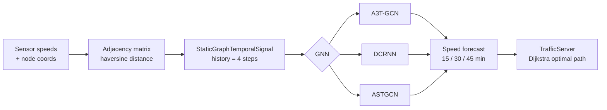

<h1 align="center">🚦 Spatiotemporal Traffic Forecasting & Optimal Path Navigation</h1>

<p align="center">
  Forecasting road-network speeds with <b>graph neural networks</b> and using the predictions to find the fastest route.
</p>

<p align="center">
  <a href="https://doi.org/10.52783/jisem.v10i10s.1360"></a>
</p>

<p align="center">
  
  
  
  
</p>

---

## 📄 Paper

This repository accompanies our published paper:

> **Exploring the Efficacy of Graph Neural Networks in Predicting Traffic Flow in India**
> Paras Patil, Vishesh Mittal, Dhruvisha Mondhe, **Akshita Upadhyay**, Nupur Giri
> *Journal of Information Systems Engineering and Management*, Vol. 10, No. 10s, 2025
> [doi.org/10.52783/jisem.v10i10s.1360](https://doi.org/10.52783/jisem.v10i10s.1360) · [PDF](https://www.jisem-journal.com/index.php/journal/article/view/1360/516)

**Key contributions**
- **DIVA** — a new *Dataset for Indian Vehicular Traffic Analysis*, built because existing benchmarks (PeMS, METR-LA) don't reflect Indian road networks
- GNNs trained on DIVA reach accuracy **comparable to the PeMSD7 / PeMSD8 benchmarks**
- A **route-navigation method** that uses predicted future speeds at each node to find the path that maximises speed and minimises travel time

<details>
<summary>📚 BibTeX</summary>

```bibtex
@article{patil2025gnntraffic,
  title   = {Exploring the Efficacy of Graph Neural Networks in Predicting Traffic Flow in India},
  author  = {Patil, Paras and Mittal, Vishesh and Mondhe, Dhruvisha and Upadhyay, Akshita and Giri, Nupur},
  journal = {Journal of Information Systems Engineering and Management},
  volume  = {10},
  number  = {10s},
  year    = {2025},
  doi     = {10.52783/jisem.v10i10s.1360}
}
```
</details>

## 📌 Overview

Traffic on a road network is both **spatial** (congestion spreads to neighbouring roads) and **temporal** (it follows daily patterns). This project models the road network as a graph — sensors/junctions are nodes, roads are edges — and trains spatio-temporal GNNs to predict speeds **15, 30 and 45 minutes ahead**. The forecasts feed a routing service ([TrafficServer](https://github.com/buildwithakshita/TrafficServer)) that computes the optimal path with Dijkstra's algorithm.

## 🧠 Models compared

| Model | Idea |
|---|---|
| **A3T-GCN** | Attention Temporal Graph Convolutional Network — GCN + GRU with attention over time steps |
| **DCRNN** | Diffusion Convolutional Recurrent Neural Network — models traffic as a diffusion process on a directed graph |
| **ASTGCN** | Attention-based Spatial-Temporal GCN — separate spatial & temporal attention blocks |

Trained models for each horizon are saved in `a3tgcn{15,30,45}mins/` and `dcrnn{15,30,45}mins/`.

## 🗂️ Datasets

| Dataset | Description |
|---|---|
| `DIVE/` | **DIVA** dataset (from the paper) — 20-node road network in Mumbai — speeds, travel times, node coordinates, adjacency |
| `PeMSD7/` | Caltrans PeMS District 7 (Los Angeles) speeds + adjacency |
| `PeMSD8/` | Caltrans PeMS District 8 (San Bernardino) speeds + adjacency |

The adjacency matrix for DIVE is built from node lat/long with the haversine distance — see `Getting the ADJ.ipynb`.

## 🔬 Pipeline



## 🚀 Run it

```bash
pip install torch torch-geometric torch-geometric-temporal pandas numpy scikit-learn seaborn matplotlib
jupyter notebook GNNs.ipynb
```

`DIVE.pdf` contains the project write-up.

## 👥 Team

Paras Patil, [Vishesh Mittal](https://github.com/Vishesh-Mittal), Dhruvisha Mondhe, Akshita Upadhyay and Nupur Giri. Licensed under MIT.
